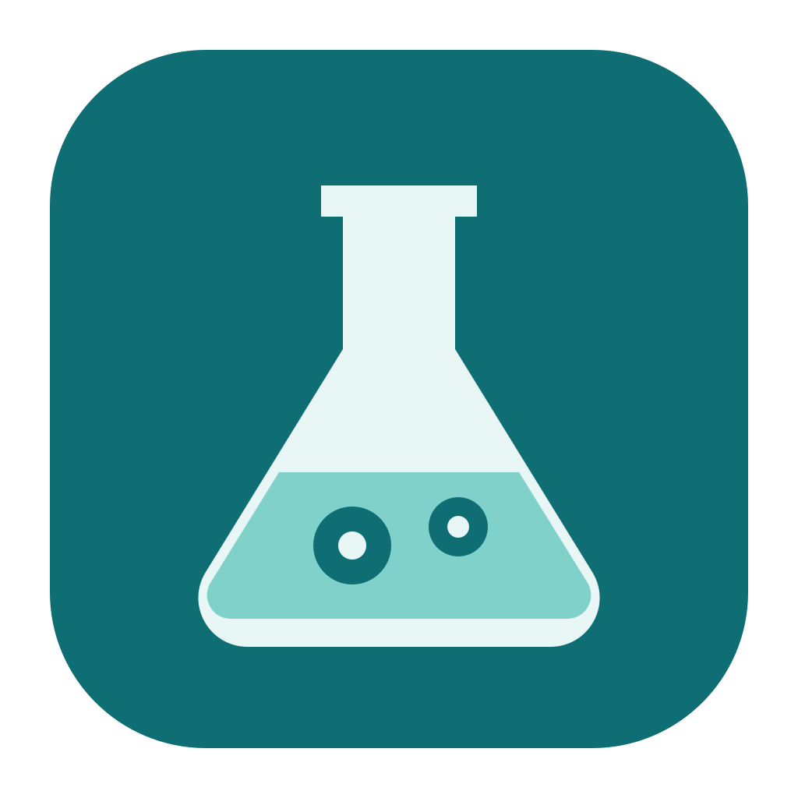

<p align="center">
  
</p>

# CellLab

**세포 stock·계대 계보, 배양 조건, Bradford/BCA 정량, Western blot 기록을 한곳에서 관리하는 macOS·Windows 앱.**

[](https://github.com/Ixon27/CellLab/releases/latest) [](https://github.com/Ixon27/CellLab/actions/workflows/release.yml) [](LICENSE)

실험 기록은 내 컴퓨터에만 저장됩니다. AI는 **문헌·분양처 페이지에서 배양 조건을 추출할 때만** 쓰며, **본인의 Claude 또는 Codex 계정**으로 실행합니다. 나머지 기능은 AI 없이 동작합니다.

## 주요 기능

| 기능 | 내용 |
|---|---|
| **세포주·stock·계대 계보** | Cellosaurus 검색으로 세포주 등록(종·조직·분양처·주의 사항 자동 입력). 입고 바이알, 해동 배양, 계대 자식 배양, 동결 lot을 계보 그래프로 표시. passage·confluency·세포 수·viability·자유 항목 기록, 혈구계산기 세포 수·접종 부피 계산, 바이알 재고·배지 교체 경과·최대 passage 경고(대시보드). |
| **배양 조건·SOP·문헌 비교** | 배양 조건 세트(배지·혈청·첨가물·항생제·계대 시약·동결 배지 등)를 선택 목록·직접 입력으로 작성. 분양처 페이지(또는 붙여넣은 내용)와 Europe PMC 오픈 액세스 논문 Methods에서 AI가 조건을 추출하고, 원문 문장 근거와 함께 논문별 비교표로 보여 줌. 선택한 조건으로 부착·부유 세포 SOP 템플릿을 채움. |
| **Bradford·BCA 정량** | 표준·마이크로·BCA(562 nm) 프리셋, 선형/2차 적합, R², blank 보정, 반복값 제외, CV·범위 경고, 희석배수를 반영한 원액 농도(µg/mL, µg/µL), 엑셀 붙여넣기, 표준곡선 차트. |
| **Western blot 실행·기록** | 겔 조성표(원문·현장 TEMED 배수), 로딩 계산(프리셋: 프로토콜 v1.1 20 µg/25 µL, 실험실 노트 20 µg/15 µL), Bradford 결과 가져오기, lane map, 항체·ECL 계산, 단계 체크리스트와 타이머, 23항목 실험 기록란, 마크다운 복사. |
| **프로토콜 라이브러리** | .docx/.md/.txt 가져오기(표 포함), 편집·미리보기, draft/확정 상태, 이전 버전 보기·복원. 기본 프로토콜: Western blot v1.1, Western blotting(실험실 노트), 부착·부유 세포 배양 SOP — 모두 draft. |

## 저장 위치

| OS | 위치 |
|---|---|
| macOS | `~/Library/Application Support/cell-lab` (`cell-lab.db`) |
| Windows | `%APPDATA%\cell-lab` |

앱 로그는 macOS `~/Library/Logs/cell-lab/desktop.log`, Windows `%APPDATA%\cell-lab\logs\desktop.log`에 남습니다.

## 외부 서비스

- **Cellosaurus**(세포주 정보), **Europe PMC**(논문 검색·전문), 분양처 웹페이지에 세포주 이름·카탈로그 번호로 조회합니다. 설정의 연락처 이메일을 넣으면 요청 헤더에 연락처로만 전달됩니다.
- Cellosaurus에는 배지 정보가 없습니다. 배양 조건은 분양처 페이지·문헌 추출·직접 입력으로만 채우며, 출처 없는 값은 넣지 않습니다.
- KCLB처럼 자동으로 읽을 수 없는 분양처 페이지는 내용을 복사해 붙여넣어 추출합니다.
- AI 추출 시 선택한 자료의 근거 문장이 선택한 AI 제공자에게 전송됩니다. 결과는 반드시 원문 근거와 대조해 확인하세요.

## 소스에서 실행 · 빌드

macOS 또는 Windows, **Node.js 24 이상**, npm이 필요합니다.

```bash
git clone https://github.com/Ixon27/CellLab.git
cd CellLab
npm ci
npm run desktop              # 전용 앱 창으로 실행
npm run install:app          # macOS: 빌드 → ~/Applications/CellLab.app 설치 + 바탕화면 바로가기
```

```bash
npm run dev                  # 웹 개발: localhost:5183, API: 127.0.0.1:4327
npm run typecheck
npm test
npm run pack:mac             # macOS: 현재 CPU용 .app → release/
npm run dist:mac             # macOS: DMG + ZIP → release/
npm run dist:win             # Windows: x64 설치 파일 → release/
```

로그인 키체인에 `CellLab Local Signing` 코드 서명 인증서가 있으면 `install:app`이 설치본을 그 인증서로 다시 서명합니다(선택).

### 환경 변수

| 변수 | 용도 |
|---|---|
| `CELL_LAB_DB_DIR` | 데이터베이스 폴더 (개발·테스트용 분리) |
| `CELL_LAB_FILES` | 첨부 파일 폴더 |
| `CELL_LAB_USER_DATA` | 데스크톱 앱 데이터 폴더 |
| `CELL_LAB_DEBUG_PORT` | 데스크톱 앱 원격 디버깅 포트 (1024–65535) |

### 프로토콜 docx 변환

```bash
npx tsx scripts/convert-docx.ts <입력.docx> <출력.md>
```

`seed/protocols/western-blot-v1-1.md`는 이 스크립트로 만든 결과입니다. 손으로 고치지 말고 변환기(`src/server/protocol-import.ts`)를 고칩니다.

### Release

`package.json` 버전과 같은 `v*` 태그를 push하면 GitHub Actions가 macOS(arm64·x64)·Windows 설치 파일을 빌드하고, 패키지 앱을 새 사용자로 실행해 확인한 뒤 Release에 올립니다. 릴리스 노트는 README의 `## <버전> 변경 사항` 절에서 가져옵니다.

## 0.1.0 변경 사항

- 첫 버전: 세포주·stock 계보, 배양 조건·SOP·문헌/분양처 비교, Bradford·BCA 정량, Western blot 실행·기록, 프로토콜 라이브러리.

## 라이선스

[MIT](LICENSE)
