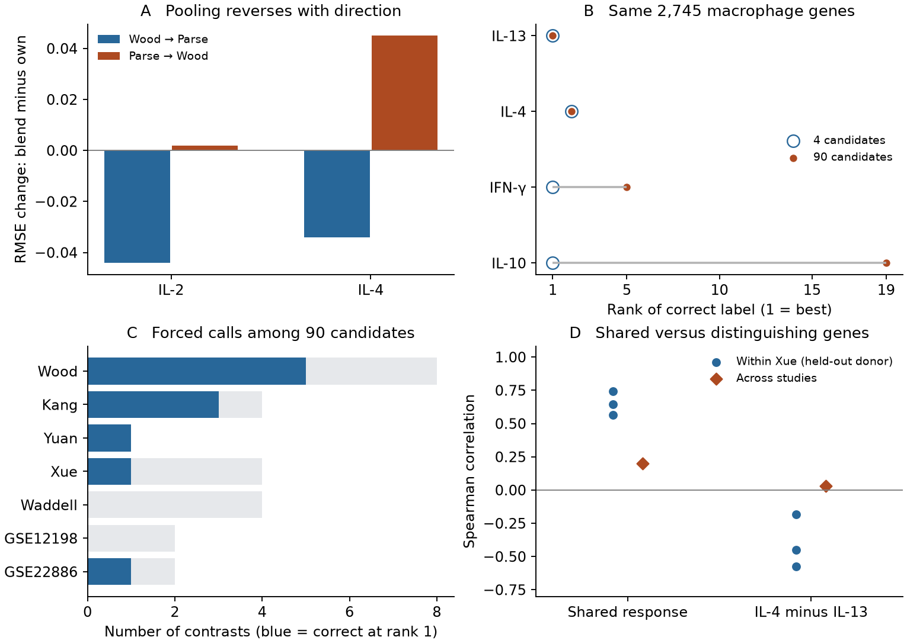
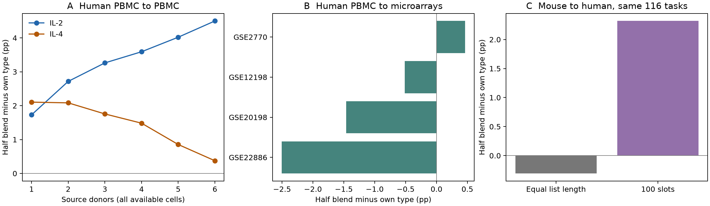

# Predicting a shared cytokine response is not the same as identifying the stimulus: a cross-study transcriptomic benchmark

**Article format:** computational benchmarking study, public-data reanalysis. This is a research manuscript draft, not a submission or a validated clinical model.

## Abstract

Can an atlas recover both a gene response and its inducing cytokine in another laboratory? We evaluated public human transcriptomic experiments against a 90-cytokine reference, separating gene-list recovery, effect magnitude, lineage and stimulus identity. Averaging matched and nonmatched lineages reduced fold-change error from Wood to Parse for IL-2 and IL-4 but increased it in reverse. In a separate IL-4 monocyte cohort, matching the source lineage without pooling recovered more of the induced shortlist from both reference studies. On identical genes from a balanced four-stimulus macrophage experiment, expanding the reference from the four studied stimuli to all 90 reduced correct first choices from three to one. The shared IL-4/IL-13 response correlated across experiments (Spearman 0.202), but their difference did not transfer well (0.031) and was not reproducible across the three macrophage donors. In two NK-cell series, each of three IL-2 contrasts ranked IL-2 second to IL-15. A score-gap rule did not reliably distinguish trustworthy predictions in held-out studies. Seven human study series supplied experimental labels for seven of the 90 candidates; this is not validation of a 90-class classifier. We provide a benchmark for distinguishing recovery of common response programs from evidence specific to an individual stimulus.

## Motivation

When a study measures relatively few cells of a particular lineage, using the other lineages' response may stabilize its gene ranking. The same operation may erase a real lineage-specific effect. Within-study reproducibility does not distinguish these possibilities in a new experiment. We ask whether partial pooling improves an actionable outcome: the fraction of a fixed shortlist recovered in another study's direction-matched list. We separate stronger ranking of available genes from merely supplying more genes to fill a budget.

The complementary inverse question is experimentally checkable without declaring thousands of unlisted genes to be negatives: can the atlas identify an administered stimulus from the measured change? Unlike predicting the magnitude of a known perturbation, identification requires outranking biologically similar alternatives. We score labels without forcing a one-to-one match, and expand candidate sets without changing the measured genes or samples.

## Design

The discovery comparison used [Kang et al.](https://doi.org/10.1038/nbt.4042) IFN-β and the [Allen analysis of the independent Parse PBMC screen](https://apps.allenimmunology.org/aifi/resources/parse-10m-cytokines/downloads/). We did not treat another redistribution of either study as independent. [Wood et al.](https://doi.org/10.1186/s13073-026-01721-y) supplied a different human PBMC experiment; nominally matched times differ (48 versus 24 h). [Waddell et al.](https://doi.org/10.1371/journal.pone.0009753) supplied time-matched sorted-cell IFN-γ and mock arrays; [Cano-Gamez et al.](https://doi.org/10.1038/s41467-020-15543-y) supplied more weakly matched polarization cocktails. Published [Cui mouse](https://doi.org/10.1038/s41586-023-06816-9) response lists tested cross-species shortlist coverage. Finally, we reversed the role of Parse and scored its predictions against independent, archived human [ImmuneSigDB](https://www.gsea-msigdb.org/gsea/msigdb/human/collections.jsp#C7) microarray contrasts. The experiments did not all measure the same lineages, ligands or gene universe; we report stratified estimates rather than meta-analyzing absolute hit rates.

In each comparison, the matching source lineage is the own-type estimate. The other-type comparator excludes that lineage. Partial pooling gives the two estimates equal weight. We compare signed top lists separately for induced and repressed genes. For array targets, scores from equally weighted memberships in published human lists have many ties; we analytically average overlap over uniform ties at the cutoff. For continuous source scores we break ties by gene symbol. Averages weight lineages (where multiple are observed) or accessions equally, not cells or number of public arrays. Full mapping, sign convention and denominators: [mouse](protocol.md), [human arrays](human-target-protocol.md), [donor model](adaptive-plan.md), [depth](depth-plan.md), [direct transfer](double-holdout.md).

## Results: candidate choice changes what can be identified

We used [Allen's continuous Parse effects](https://apps.allenimmunology.org/aifi/resources/parse-10m-cytokines/downloads/) as a fixed library. Each external query was a treatment-minus-control gene response in a known lineage. We ranked the 90 reference stimuli by Spearman correlation to the external response, without fitting to the target labels. We retained only genes observed across all candidate stimuli and four reference lineages, then intersected them with each assay. Thus every candidate within a comparison had the same genes. CD14 monocytes served as the nearest reference for differentiated macrophages; we do not equate these states. All group-level scores, including off-diagonal candidates, are [available](../cytokine-effects/results/catalogue_all_scores.csv). Most of the 90 ligands are distractors only, not tested positive classes.

In [Yuan et al.](https://doi.org/10.1038/s41467-026-78528-3), IL-4 ranked first in M-CSF-conditioned monocytes at both 24 h (three replicate pairs) and 6 h (two pairs). Pairing was inferred from replicate labels; the individuals' identities across times are not established. In [Xue et al.](https://www.ncbi.nlm.nih.gov/geo/query/acc.cgi?acc=GSE46903), three different donors each contributed a control and all four single-ligand exposures in differentiated macrophages at 72 h. On the initially defined four-way, 2,964-gene panel the matched monocyte reference correctly identified three of four stimuli; actual IL-4 ranked below IL-13. The same calls held when restricting to the 2,745 genes measurable for all 90 candidates. With those genes and the same target data, expanding **only** the candidate list gave true ranks of 1 (IL-13), 2 (IL-4), 5 (IFN-γ) and 19 (IL-10). Thus apparent accuracy fell even without changing gene coverage. The shared component of IL-4/IL-13, their mean, correlated across laboratories at 0.202; the distinguishing component, their difference, at 0.031. Within Xue, each donor's difference correlated negatively with the mean difference in the other two (mean −0.402), while shared responses were positively correlated (mean 0.650). This is evidence of an unstable difference **in this panel**, not biological equivalence of the ligands.

There were five correct top choices among eight Wood lineage-by-ligand queries, three of four in Kang and none of four in Waddell. Wood's IL-2 confusion was with IL-7 in monocytes, B and CD4 cells, whereas NK ranked IL-2 first. We reanalysed the deposited expression matrices, rather than the previously used curated lists, for [GSE12198](https://www.ncbi.nlm.nih.gov/geo/query/acc.cgi?acc=GSE12198) and [GSE22886](https://www.ncbi.nlm.nih.gov/geo/query/acc.cgi?acc=GSE22886). Both doses of IL-2 in the former and the IL-2 arm in the latter ranked IL-15 first and IL-2 second; actual IL-15 in the latter ranked first. Each study used a common control for its contrasts. These four contrasts are not four independent replications. We did not infer donor pairing from array replicate suffixes or count the two chips of GSE22886 as separate samples.

A post-hoc [study-blocked rejection test](../cytokine-effects/confidence-plan.md) asked whether a large gap between the two highest correlations justified reporting a single name. We selected the most permissive gap meeting 80% weighted correctness in the other studies, subject to coverage in at least three studies and two ligands. Without a feasible threshold we abstained. Across five leave-study-out folds (Yuan 24 h only), the rule made calls on 2/21 contrasts; both were incorrect, both in Waddell. Training on all five studies yielded no feasible threshold; the frozen rule abstained on all four NK contrasts. The small, uneven class mix is insufficient for learning a deployable confidence rule. These checks are descriptive extensions, not an untouched validation of a universal classifier.

**Figure 1.** A: negative values favour pooling in the indicated source-to-target direction. B: only candidate identities change between the two markers on each row. C: bars count experimental contrasts, not independent donors; only the primary Yuan time is included. D: blue markers compare a held-out Xue donor with the other two; diamonds compare the Parse reference with the mean Xue response.

## Results: smaller prediction errors do not imply better lineage identification

We compared mean gene-wise effect errors on the same observed genes: 3,259 (IL-2) and 3,334 (IL-4) from the filtered Wood profiles had finite Allen estimates in all four lineages. At six Wood donors, matched-lineage versus equal-blend RMSE was 0.296 versus 0.252 and 0.311 versus 0.277, respectively. Reversing source and target changed the blend's errors to 0.298 and 0.356, now worse than the same unpooled reference. Weighted resampling of the six Wood donors supported a forward error reduction conditional on the fixed target, not across all studies. On Kang → Parse, even a zero-change prediction had lower error than either own or pooled effects; absolute error and ranking agreement measure different properties. Across 36 sufficiently covered Hallmark sets, the forward blend improved overall pathway rank agreement but **not** lineage-centered agreement for either ligand. These pathway scores reuse the same gene data and are not an additional validation cohort.

There is a simple reason why globally weighting lineages can improve magnitude without changing which lineage ranks first. For a gene with $m$ lineage effects $x_i$, mean $A$ and common own-lineage weight $w$, the pooled prediction is $A+[(mw-1)/(m-1)](x_i-A)$. For $w>1/m$ the ordering, including ties, is unchanged. Consequently, a half blend cannot improve maximum-lineage identification in this four-lineage design. A matrix of different weights fitted on source donors can break that constraint. It lowered error further, but maximum-lineage accuracy rose on IL-2 (45.8% to 47.8%) and fell on IL-4 (57.9% to 57.4%). The source-only model failed the joint advancement criterion. [Continuous results, reverse baselines, code and local analysis plans](../cytokine-effects/README.md).

## Results: independent monocytes and a count-based comparator

At Yuan 24 h the nearest-lineage Wood and Parse rankings recovered 82.5% and 76.0%, respectively, of directional shortlist slots against the target top 500 **within each source's measurable universe**. Their half blends recovered 81.0% and 74.0%. These percentages average induced and repressed directions; the platforms have different universes and cannot be compared head to head by those values. When retaining the target's entire assay to define the top 500, the corresponding own-type recoveries were 58.0% and 24.5%. In particular, the Parse universe contained just 48 of the target's globally top 500 induced and 39 of its top 500 repressed genes. The gap separates selection of good genes from the inability to recommend unobserved genes. [Cohort provenance and complete directional results](../cytokine-new-cohort/README.md).

A paired, donor-blocked TMM/edgeR quasi-likelihood count analysis tested whether the pooling result survived a standard alternative to fold-change ranking. For Wood → Parse, on the same broad CPM-filtered genes, own-lineage versus post-fit rank pooling recovered 43.6% versus 41.9% (IL-2) and 59.8% versus 40.0% (IL-4). On Yuan's whole-assay IL-4 target these were 57.0% versus 31.5%. On a stricter intersection of source expression filters, edgeR's own-type advantage over matched limma own-type ranks on Parse narrowed to 3.1 and 5.5 percentage points. Changing filters changes the recoverable target genes; post-fit rank averaging is not a joint donor-level count model. [Comparators, genes and complete contrasts](../cytokine-count-model/README.md).

## Results: a donor-count threshold did not transfer

Across six paired donors in Wood batch B, four eligible lineages contributed 15,151 cells; naïve CD8 failed the minimum cell count. With a single donor, own versus blend up-list precision was 3.25% versus 6.33% (IL-2) and 10.04% versus 12.96% (IL-4). At all six donors the blend still led on the up lists (19.25% versus 12.25%; 25.50% versus 24.25%). Thus the transition seen in the discovery cohort, from pooling to own-type advantage, did not reproduce as a general donor threshold. The blend ranked first in 22 of the 24 ligand × direction × donor-count summaries; these overlapping summaries are not 24 independent studies. [Donor curve](../cytokine-single/results/macro.csv).

The locked donor-variance shrinkage rule failed its advancement criterion. Its mean directional hit rates at six donors were 14.38% versus 14.63% for the fixed blend on IL-2, and 21.13% versus 21.25% on IL-4. We did not retune the weights. As a separate, post-hoc sensitivity, we required ≥1 CPM in ≥6 lineage/donor/arm pseudobulks for each ligand. On the same filtered universe we compared mean fold change to an intercept-only [limma](https://doi.org/10.1093/nar/gkv007) empirical Bayes model of the six paired donor differences. Borrowing was applied within donor before variance moderation. This is not a voom fit. Filtering alone gave own/blend of 10.25%/14.63% (IL-2), 20.88%/21.63% (IL-4). Ranking by moderated t instead gave **22.00%/22.25%** and **38.88%/33.38%**. Improving the ranking statistic had a larger effect here than changing the pooling weight; the IL-4 method ordering changed. This comparison was motivated by the main results and is not an independent confirmation of the best statistic. [Full stratum results](results/moderated_by_type.csv).

In a fixed-depth control we sampled 282 monocytes, 24 naïve B, 36 naïve CD4 and 18 NK cells **per condition**, distributing each lineage's budget across 1, 2, 3 or 6 donors. The per-donor log-CPM estimator was held fixed. On the up-list the blend's mean hit rate increased from 9.25% to 34.13% (IL-2) and from 15.78% to 47.04% (IL-4) between one and six donors. We then randomly reassigned the sampled cells to condition within donor/lineage, retaining the cell counts. Even with labels removed, six-donor values were 5.29% and 5.94% (one donor: 1.03% and 0.84%). This post-hoc negative control makes two points: actual labels supplied information, but part of the dependence on donor partitioning persists without treatment information. The number of cells entering each logarithm also changes with partitioning. Neither this comparison nor the original all-cell donor curve identifies a causal recruitment benefit. [Matched-depth estimates](results/depth_macro.csv) and [negative control](results/depth_null_macro.csv).

## Results: target choice changes the answer

For the four curated human microarray accessions, matching the source cell type recovered 4.00 of 100 genes on average, versus 2.99 for the half blend and 1.87 for other types alone. The blend lost in three of four accessions. Paired differences after removing one accession at a time were −1.50 to −0.51 percentage points. The two Turku CD4 series share a senior investigator; weighting them as one group yielded −1.17 points. The largest absolute recovery was for GSE22886 NK cells; removing that accession reduced own-type recovery from 4.00% to 1.70%. Matched ligands did not consistently outperform other ligands, particularly in the 7-day culture comparison. These low absolute values argue against labeling genes outside a target list as biological negatives.

To remove dependence on Parse as either source or target, we also predicted the three overlapping archived IL-2/4 target series directly from Wood. At six donors, mean precision was 4.22% own versus 4.39% blend; own won in GSE22886 and lost in the other two. The difference was similarly small at one donor (+0.18 points for the blend). Thus the advantage on Wood → Parse did not translate into a comparably large improvement on these different targets. These target lists were already used for the Parse → array analysis; this is a new study pairing rather than untouched targets for the entire project. [Independent pairings](results/double_holdout.csv).

The direct filtered, moderated comparison further illustrates the risk of selecting the best method on one target. In GSE2770, ranking Wood's IL-4 response by fold change gave 0.67% own versus 1.17% blend; moderated ranks gave 1.83% versus 1.33%. On the two NK accessions, the moderated blend tied or modestly exceeded own. These are very small differences across short experimental lists, not evidence of statistical superiority. [Moderated double holdout](results/moderated_double_holdout.csv).

In the opposite direction, using the 24-hour Waddell IFN-γ experiment to predict human PBMC lists, the shared all-lineage mean recovered 21.63% of the up list, compared with 11.75% for own type. The half blend recovered 19.00%. On the down list the best of these estimators was the half blend at 4.88%, only modestly above the uniform-gene reference of 3.37%. Averaging naïve and memory CD4 responses also helped in the polarization comparisons. Because those source cocktails included blockade, they cannot be counted as replications of the corresponding single cytokine. [All purified-cell results and measurement units](../cytokine-sorted/RESULTS.md).

## Results: apparent gains can come from filling the shortlist

With the mouse atlas as source, partial pooling filled more of a 100-gene recommendation budget. For 22 non-discovery ligands and 220 lineage/direction tasks it achieved 9.99% versus 6.94% for own type. When all methods instead supplied the same number of genes (at least 10), their estimates were 14.58% versus 14.89% on 116 tasks. Importantly, on **those identical 116 tasks**, the 100-slot scoring rule still favored the blend by 2.32 points. Changing only the budget rule therefore changed the sign. The unreported mouse effects are unknown, not measured zeros; this analysis applies to published filtered signatures, not dense expression matrices. Cross-species comparison is already present in the [human cytokine dictionary](https://pubmed.ncbi.nlm.nih.gov/41446101/); our contribution is the explicit denominator and borrowing comparison, not the first cross-species atlas.

## Interpretation and boundary of evidence

The decision is about ranking under an observation budget, not the identification of a biological universal. The same study and donors can contribute to several contrasts. A new stimulus evaluated against the same Parse study is an independent source test, not a new target cohort. Some microarray controls differ in activation state, time in culture and baseline composition; genes unavailable on an older assay may depress absolute retrieval. Gene symbols, cross-species mappings and subtype mismatches add measurement error. This study does not establish causality, predict patient response or demonstrate diagnostic performance. Results are descriptive; donor subsets, cells, ligands and lists are not independent replications for a pooled P value. The analysis plans were saved locally before scoring their corresponding endpoints; they were not externally preregistered.

Recent [perturbation-prediction benchmarking](https://doi.org/10.1038/s41592-025-02980-0) already emphasizes the need for strong simple baselines. We do not claim that a new architecture is needed or that these baselines outperform pretrained models. Our evidence addresses a narrower issue: compare the same experimental contrast on the same genes, under a wider reference and against the closest wrong ligand. Seven studies provide labels for seven distinct stimuli, and platforms, cell states, treatment times and donors are not independently crossed. A larger, balanced near-neighbour panel and a head-to-head pretrained-model comparison with documented pretraining overlap would be necessary to support stronger generalization claims.

## Data and code availability

See the [reproduction commands](README.md), [source counts and study-level metadata](../cytokine-single/sources.json) and [array/cocktail sources](../cytokine-sorted/RESULTS.md). Code checks input release checksums; derived summaries, not participant-level data or commercial-use rights to the source resources, are included. No newly collected samples, model weights trained on target labels or private CellLab records are used.
